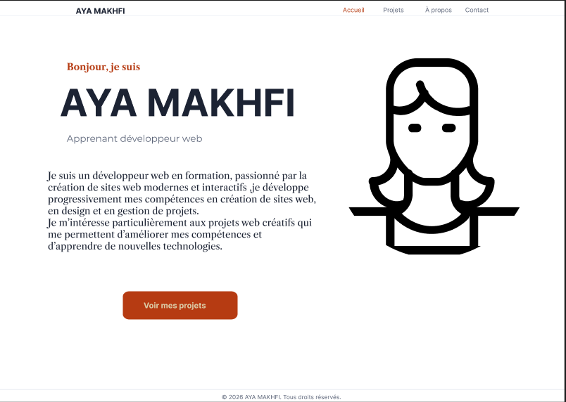
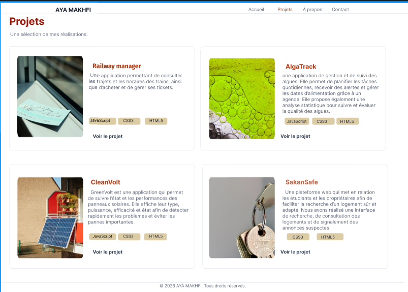
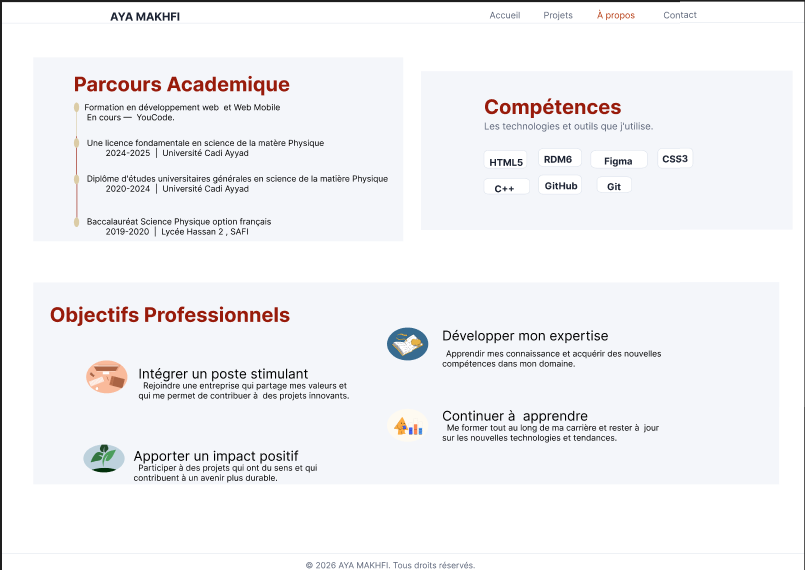
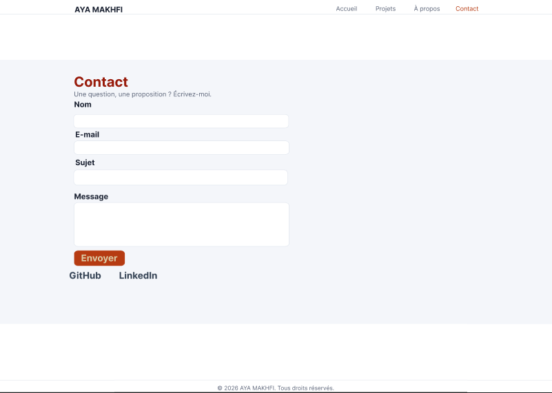

# Portfolio —Personnel-MAKHFI AYA
Ce projet est un portfolio personnel développé dans le cadre de ma formation en développement web et web mobile .
il permet de presenter mon profil,mes compétences,mon parcours académique,mes objectifs professionnels et mes projets.
Le site posséde une interface moderne,avec une charte graphique personnalisée et un groupes de page reliées par un menu de navigation.

## Outils utilisés
- HTML5
- CSS3
- CSS Grid
- fLExbox
- Figma
## Modification apportées au modéle initial
 1- Déplation de la section compétences:
  d'éplacé vers la nouvelle page ajouter.
 2-Réorganisation de l'affichage des projets:
 utilisation de css grid pour afficher les projets sous forme d une matrice .
 3- création d'une quatriéme page sous le nom de Á-propos:
 contient les compétence le parcours académique et les objectifs professionnels.
 4- Amélioration du formulaire de contact:
   l'addition d une zone (Sujet) ainsi que la vérification de de l'association entre les labels et les champs du formulaire et les types de champs. 
   
## Lien Figma
[lien figma]
(https://www.figma.com/design/ptUYZ9UTzeqtazRzTtbjJA/Portfolio?node-id=0-1&t=Fs44Swmz9rvAorea-1)

## Maquette Figma





## Projet Structure
```text
portfolio/
│
├── index.html
├── projets.html
├── a-propos.html
├── contact.html
│
├── css/
│   └── style.css
│
└──images/
     ├── img projet1.jpg
     ├── img projet2.jpg
     ├── img projet3.jpg
     ├──img projet4.jpg
     ├── maquette1
     ├── maquette2
     ├── maquette3
     └── maquette4


```
## Auteur
### MAKHFI AYA


